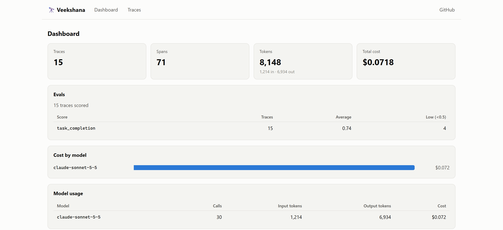
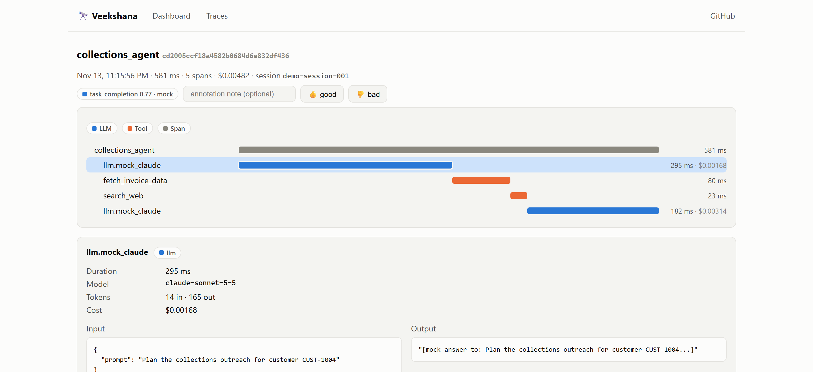

# Veekshana 🔭

**Open-source observability for AI agents.** Traces, costs, and evals for LLM applications — self-hosted, in under 2 minutes.

[](LICENSE)
[](sdk-python/)
[](docs/GUIDE.md#33-already-on-opentelemetry-skip-the-sdk)

> వీక్షణ (*Veekshana*) — "observation" in Telugu and Sanskrit. See what your agents are actually doing.

> ⚠️ **Early development.** APIs will change. Star the repo to follow along.

<picture>
  <source media="(prefers-color-scheme: dark)" srcset="docs/images/dashboard-dark.png">
  
</picture>

<picture>
  <source media="(prefers-color-scheme: dark)" srcset="docs/images/trace-dark.png">
  
</picture>

## Why Veekshana?

You shipped an AI agent. Now you need to know:

- **What is it doing?** Full traces of every agent run — LLM calls, tool calls, inputs, outputs — as a waterfall you can click into.
- **What does it cost?** Token usage and spend per model, per feature, per session. Latency p50/p95.
- **Is it actually working?** LLM-as-judge evals on sampled traces. Flag bad runs, catch regressions when you change prompts or models.

## Quickstart

### 1. Run the stack

```bash
docker compose up
```

That's it: API at `http://localhost:8787`, web UI at `http://localhost:3000`, SQLite on a Docker volume (Postgres: see `docker-compose.yml`). Default API key is `dev-key` — override with `VEEKSHANA_API_KEY=... docker compose up --build`.

<details>
<summary>Without Docker</summary>

```bash
cd server
pip install -e . -e ../sdk-python
veekshana-server
```

The server starts at `http://localhost:8787` with a local SQLite database. (Postgres: set `VEEKSHANA_DATABASE_URL`.) Then run the web UI from `web/` with `npm install && npm run dev`.

</details>

### 2. Instrument your agent

```bash
pip install -e sdk-python
```

```python
import veekshana

veekshana.init(host="http://localhost:8787", api_key="dev-key")

@veekshana.observe()
def my_agent(question: str) -> str:
    # your agent logic — LLM calls inside are captured automatically
    ...
```

Anthropic and OpenAI clients are auto-instrumented: every `messages.create` / `chat.completions.create` / `responses.create` call is captured with model, tokens, cost, and latency — zero code changes. The OpenAI wrapper also covers every OpenAI-compatible provider used through the OpenAI SDK with a custom `base_url`: Groq, Together, Ollama, OpenRouter, DeepSeek, Mistral, Gemini's compat endpoint, and friends.

**Already instrumented with OpenTelemetry** (OpenLLMetry, Phoenix, Langfuse v3, or your own GenAI spans)? Skip the SDK entirely — point your exporter at Veekshana:

```bash
export OTEL_EXPORTER_OTLP_TRACES_ENDPOINT=http://localhost:8787/v1/traces
export OTEL_EXPORTER_OTLP_TRACES_HEADERS=x-api-key=dev-key
```

Veekshana accepts OTLP/HTTP (protobuf and JSON) and maps GenAI semantic conventions — model, token usage, prompts/completions, tool calls, sessions, errors — automatically. See [examples/otel_agent.py](examples/otel_agent.py).

### 3. See your traces

Open [http://localhost:3000](http://localhost:3000): dashboard with cost/token stats, traces list, and a click-through trace waterfall with per-span latency, cost, and input/output inspection.

Prefer raw JSON? `curl http://localhost:8787/api/v1/traces -H "x-api-key: dev-key"`

### 4. Score your traces (evals)

```bash
docker compose exec server veekshana-eval        # LLM-as-judge (set ANTHROPIC_API_KEY)
docker compose exec server veekshana-eval --mock # deterministic mock judge, no key needed
```

Each trace gets a `task_completion` score with reasoning, shown on the dashboard and trace pages, where you can also annotate runs 👍/👎 by hand. Judge model: `VEEKSHANA_EVAL_MODEL` (default `claude-opus-5-5`).

**Describe what your agent is supposed to do**, and the judge scores against *your* definition of correct:

```bash
veekshana-eval --criteria "Drafts polite payment reminders, never threatens, always includes the exact overdue amount."
```

The judge runs on **your** API key (any Claude model) — or the keyless mock judge. Veekshana itself has no AI vendor dependency.

### 5. Multiple teams, one server

```bash
VEEKSHANA_API_KEYS="agents-key:collections,bot-key:support" docker compose up
```

Each key sees only its own project's traces, stats, and scores. With no configuration, everything lands in a single `default` project.

## Documentation

**[The Complete Guide](docs/GUIDE.md)** — what Veekshana is, component map, full usage (SDK, OTLP, UI, evals, API reference), how it works inside, and an honest deployment-readiness checklist.

## Repository layout

```
sdk-python/   Python SDK — @observe decorator, auto-instrumentation, batched exporter
server/       FastAPI ingestion + query API (SQLite / Postgres)
web/          Next.js trace viewer + cost dashboard
docker/       Dockerfiles (compose file is at the repo root)
docs/         Quickstart and SDK reference
examples/     Instrumented demo agents
```

## Roadmap

- [x] Python SDK: `@observe`, trace context, batched ingestion
- [x] Anthropic auto-instrumentation + cost tracking
- [x] FastAPI ingestion + query API
- [x] Web UI: trace waterfall, traces list, cost dashboard
- [x] Evals v1: LLM-as-judge on sampled traces, manual annotation
- [x] OTLP ingest (OpenTelemetry GenAI semantic conventions, protobuf + JSON)
- [x] OpenAI auto-instrumentation (covers OpenAI-compatible providers via base_url)
- [x] Custom eval criteria (describe what your agent should do, in plain English)
- [x] Per-project API keys (multi-team isolation on one server)
- [ ] Streaming call capture (Anthropic + OpenAI)
- [ ] TypeScript SDK
- [ ] Gateway/proxy mode (zero-code logging)

## Contributing

Issues and PRs welcome — see [CONTRIBUTING.md](CONTRIBUTING.md). The whole codebase is small enough to read in an evening; that's deliberate.

## License

[Apache 2.0](LICENSE)
